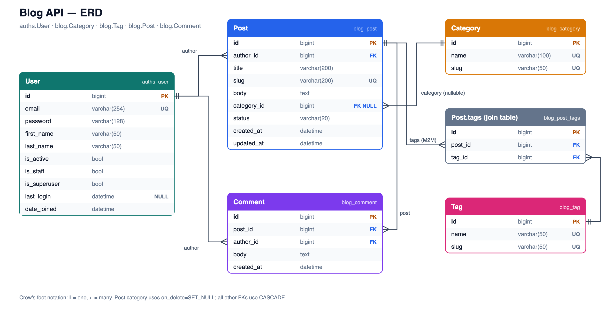
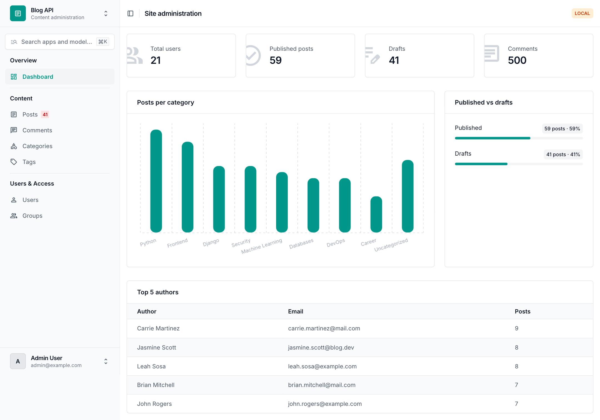
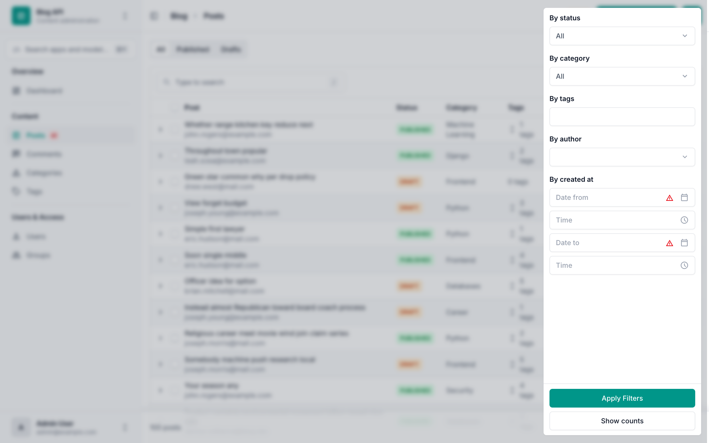
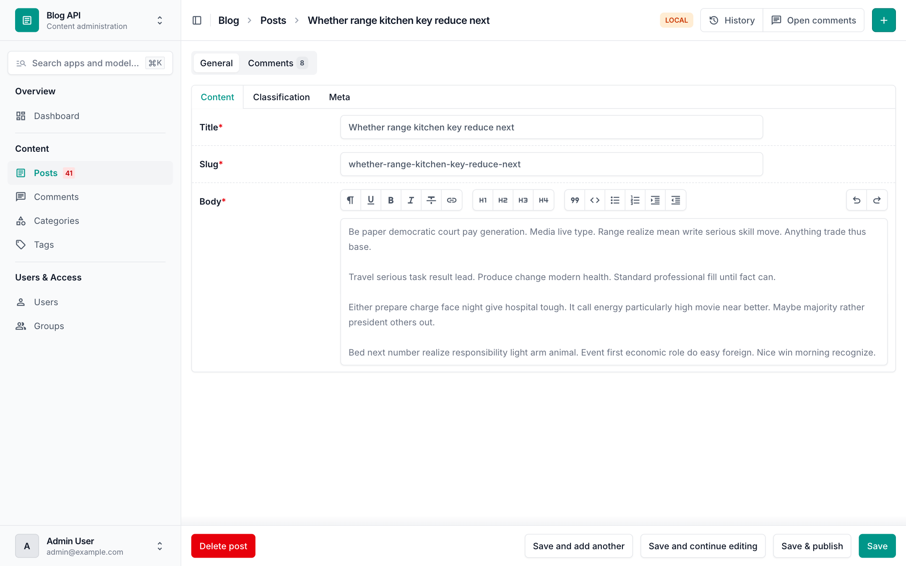
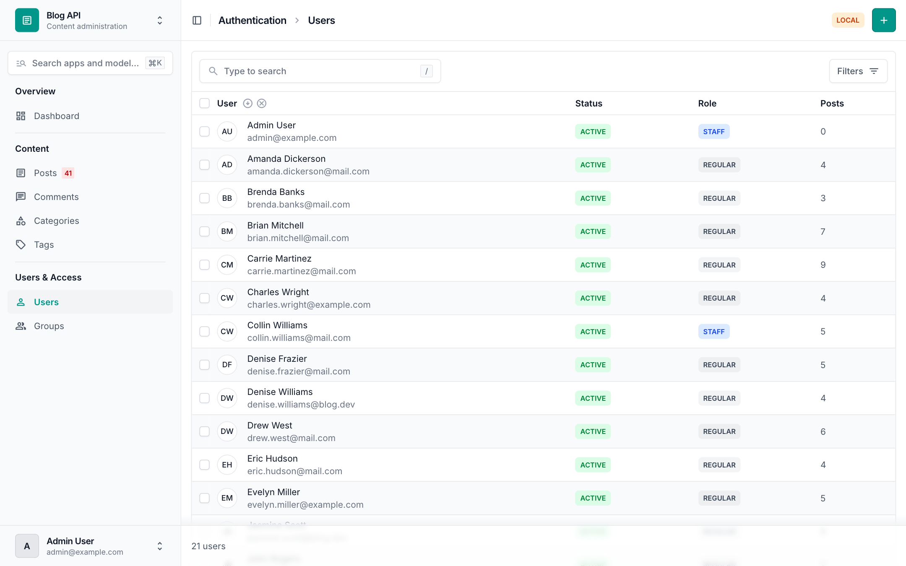

# Blog API

A blog REST API built with Django and Django REST Framework.

## ERD



## Project structure

```
blog-api/
├── manage.py
├── requirements/
│   ├── base.txt
│   ├── dev.txt
│   └── prod.txt
├── logs/
├── apps/
│   ├── auths/          custom user model, JWT authentication
│   └── blog/           posts, comments, categories, tags
├── docs/
├── templates/          admin template overrides
└── settings/
    ├── .env            secrets (not committed)
    ├── .env.example
    ├── conf.py         reads .env with python-decouple
    ├── base.py         shared settings
    ├── urls.py
    ├── wsgi.py
    ├── asgi.py
    └── env/
        ├── local.py    DEBUG=True, SQLite
        └── prod.py     DEBUG=False, PostgreSQL
```

`manage.py` reads `BLOG_ENV_ID` from `settings/.env` and uses `settings.env.<BLOG_ENV_ID>`
as `DJANGO_SETTINGS_MODULE`.

## Getting started

```bash
python3 -m venv .venv
source .venv/bin/activate
pip install -r requirements/dev.txt
cp settings/.env.example settings/.env
python manage.py migrate
python manage.py createsuperuser
python manage.py runserver
```

Set `BLOG_SECRET_KEY` in `settings/.env` to a long random string.

## Environment variables

| Variable             | Description                                   |
|----------------------|-----------------------------------------------|
| `BLOG_ENV_ID`        | `local` or `prod`                             |
| `BLOG_SECRET_KEY`    | Django secret key                             |
| `BLOG_ALLOWED_HOSTS` | Comma-separated list of hosts                 |
| `BLOG_DB_*`          | PostgreSQL connection for `prod`              |
| `BLOG_REDIS_URL`     | Redis connection URL                          |
| `BLOG_SQL_LOGGING`   | `True` prints every SQL query in `local`      |

## Seeding

`python manage.py seed` fills the database with fake users, categories, tags, posts and comments.

| Argument     | Default | Description                         |
|--------------|---------|-------------------------------------|
| `--users`    | `20`    | Number of users to create           |
| `--posts`    | `100`   | Number of posts to create           |
| `--comments` | `500`   | Number of comments to create        |
| `--clear`    | off     | Delete existing data before seeding |

`--clear` deletes comments, posts, tags, categories and every user except superusers.
All seeded users share the password stored in `SEED_PASSWORD`
(`apps/blog/management/commands/seed.py`).

```
$ python manage.py seed --users 50 --posts 300 --comments 1500
Users:       50 created
Categories:   8 created
Tags:        20 created
Posts:      300 created
Comments:  1500 created
Done in 0.30 seconds
```

From an empty database to a working admin full of data:

```bash
python manage.py migrate
python manage.py seed
python manage.py createsuperuser
python manage.py runserver
```

## Admin

The admin uses [Django Unfold](https://unfoldadmin.com/): a custom dashboard, sidebar with a
drafts badge, Cmd+K search, post tabs (All / Published / Drafts), dropdown and autocomplete
filters, row/list/detail/submit-line actions and a WYSIWYG editor for posts.

### Dashboard



### Post list with filters



### Post edit page



### User list



## Authentication

Login uses email instead of username. JWT tokens:

- `POST /api/auth/token/` with `email` and `password`
- `POST /api/auth/token/refresh/` with `refresh`

## Linting

```bash
ruff check .
ruff format .
```
